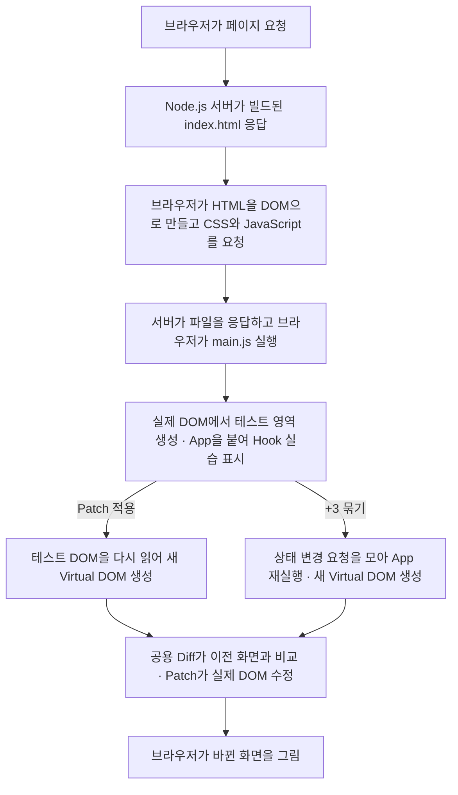
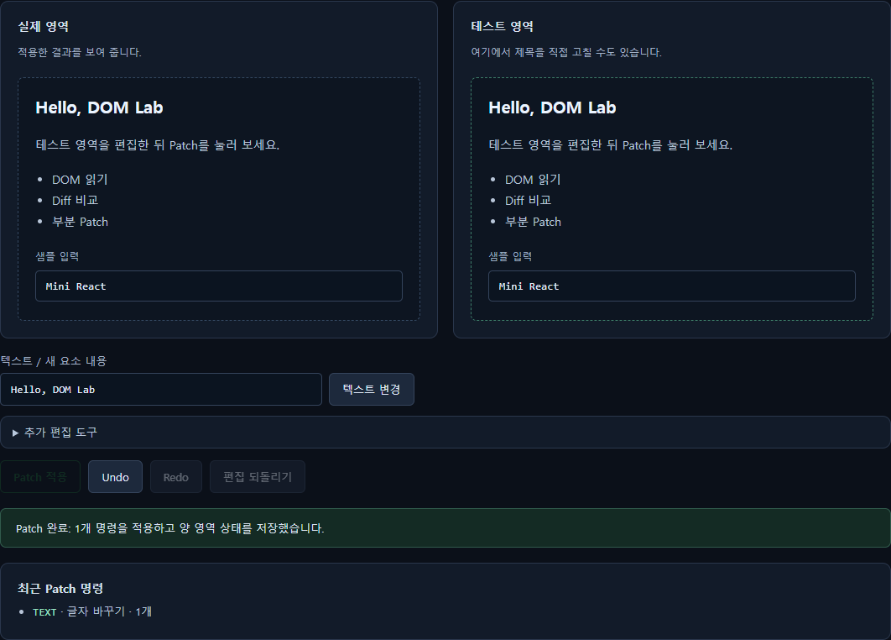
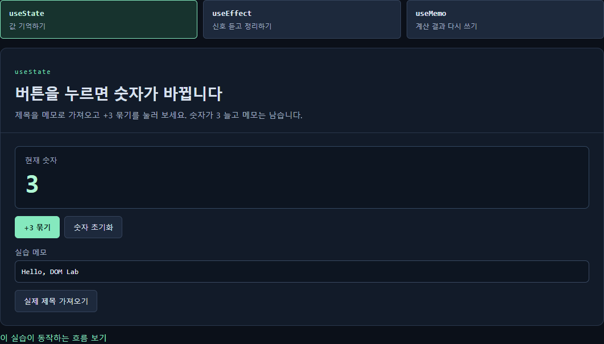

# Mini React Lab

위에서 고친 제목을 아래 메모로 가져온 뒤, 위쪽에서 **Undo**를 누르면 어떻게 될까요? 제목은 돌아가고 메모는 남습니다. **Mini React Lab**은 같은 글자라도 화면을 직접 편집한 경우와 앱 상태에 저장한 경우에 어떤 일이 일어나는지 확인하는 학습 사이트입니다.

## 브라우저 요청부터 화면 갱신까지

서버는 처음 화면에 필요한 파일을 보내고, **Patch 적용**과 **+3 묶기**는 브라우저 안에서 처리합니다.

## 제목 하나를 바꾸고 변경 명령을 확인합니다

오른쪽에서 **텍스트 변경**을 누르면 테스트 제목만 `Hello, DOM Lab`으로 바뀝니다. **Patch 적용**을 누른 뒤에는 왼쪽도 같은 제목이 되고, 아래에 `TEXT · 글자 바꾸기 · 1개`가 뜹니다.

적용 버튼을 누르면 오른쪽 DOM을 다시 읽어 왼쪽의 마지막 적용본과 비교합니다. 제목 글자만 달라서 Diff가 글자 변경 명령 한 건을 만들고, Patch는 기존 제목에서 그 글자만 고칩니다. **Undo와 Redo**도 저장한 화면으로 두 영역을 갱신할 때 같은 엔진을 씁니다.

## 같은 제목을 메모로 가져옵니다

**실제 제목 가져오기**는 적용이 끝난 왼쪽 제목을 읽어 메모에 복사합니다. 이어 **+3 묶기**를 누르면 숫자가 3으로 바뀝니다. 여기서 위쪽의 **Undo**를 누르면 두 영역의 제목은 처음으로 돌아가고, 아래 메모에는 방금 복사한 글자가 남습니다. 위쪽은 적용한 화면을 History에 저장하고, 아래쪽은 복사한 글자를 `App`의 State에 저장하기 때문입니다.

**+3 묶기**에서는 `useState`에 1을 더하는 요청을 세 번 보냅니다. 앞 요청의 결과를 이어받아 0에서 3까지 계산한 뒤, `App`이 새 Virtual DOM을 만들고 제목을 바꿀 때와 같은 Diff/Patch로 화면에 반영합니다.

**구독 실습**에서 A를 듣다가 B로 바꾼 뒤 A 신호를 다시 보내면 받은 수가 그대로입니다. `useEffect`의 cleanup이 A 연결을 끊었는지 숫자로 확인할 수 있습니다. **계산 실습**에서는 기준을 저장한 뒤 **보기 전환**과 **수량 +1**을 눌러 봅니다. 보기만 바꾸면 `useMemo`가 이전 결과를 쓰고, 수량을 바꾸면 다시 계산합니다. 화면이 갱신되는 일과 합계를 다시 계산하는 일을 구분해서 보여 주는 예입니다.

## 실제 React와 어떤 점이 다른가요?

실제 React는 컴포넌트가 만든 다음 UI를 이전 트리와 맞춰 보고, 필요한 DOM 변경을 커밋 단계에서 반영합니다. 저희도 화면을 비교하는 일과 DOM에 적용하는 일을 나눴습니다. 이 사이트에서는 **편집한 DOM도 비교의 입력으로 삼고**, Diff가 만든 명령을 화면에 표시해 직접 살펴볼 수 있게 했습니다.

상태를 두는 범위도 다릅니다. 실제 React에서는 각 함수형 컴포넌트가 자기 Hook을 가질 수 있습니다. 저희는 과제 조건에 맞춰 루트 `App` 한 곳에서 상태를 관리하고, 숫자·구독·계산 화면에는 필요한 값과 버튼 동작을 props로 넘깁니다.

Diff는 같은 요소를 어떻게 알아보나요?

같은 부모 아래에서 키가 있는 요소는 `key`로, 키가 없는 요소끼리는 순서대로 짝을 찾습니다. 같은 키여도 태그가 다르면 교체합니다. `data-key="heading"`은 편집 도구가 제목을 찾을 때 쓰는 HTML 속성이며, 우리 엔진이 DOM을 읽을 때 Virtual DOM의 키로도 사용합니다. 실제 React의 JSX `key`는 React 내부에서 항목을 대응시키는 데 사용됩니다.

| 바뀐 것 | 실제 DOM에 적용하는 방법 |
| --- | --- |
| 글자 | 기존 제목의 글자만 바꿉니다. |
| 속성 | 기존 요소에 클래스를 붙이거나 뗍니다. |
| 추가 | 목록에 새 항목을 넣습니다. |
| 삭제 | 선택한 항목을 빼냅니다. |
| 교체 | 선택한 요소를 다른 태그로 바꿉니다. |

Patch를 적용한 뒤 브라우저는 무엇을 하나요?

브라우저가 바뀐 DOM을 화면에 그립니다. 긴 제목 때문에 줄이 늘면 위치와 크기를 다시 계산할 수 있습니다(**Reflow**). 색이 바뀌면 다시 그리는 작업이 생깁니다(**Repaint**). DOM 변경 범위를 줄이면 이런 작업도 줄일 수 있습니다.

우리 코드에서는 `Document`로 실습 영역과 버튼을 찾고 요소를 만듭니다. `Window`에서는 페이지를 떠날 때 발생하는 이벤트를 받아 Hook 연결을 정리합니다. `MutationObserver`는 테스트에서 변경 사항이 없는 Patch가 DOM을 건드리지 않는지 확인하는 데 사용했습니다.

App 함수가 다시 실행돼도 상태가 남는 이유는 뭔가요?

`FunctionComponent`의 `mount()`가 처음 화면을 만들고, 상태가 바뀌면 `update()`가 다음 화면을 계산합니다. Hook을 호출한 순서가 같으면 배열에서 이전과 같은 칸을 찾아 값을 꺼낼 수 있습니다. 숫자·메모·구독 상태는 각자 다른 칸에 저장합니다. 이처럼 공통 상태를 부모에 두고 자식에게 값을 넘기는 구조가 **Lifting State Up**입니다.

HTML · CSS · TypeScript로 구현했습니다. 브라우저에서는 컴파일한 JavaScript가 실행됩니다.
